# <center>学习Moveit2</center>  
- [学习Moveit2](#学习moveit2)
  - [编译与运行](#编译与运行)
    - [编译](#编译)
    - [运行](#运行)
  - [foxy版本运行成功日志](#foxy版本运行成功日志)
  - [发展历程](#发展历程)
    - [主要的功能](#主要的功能)
  - [Moveit2代码框架及概念](#moveit2代码框架及概念)
    - [规划接口](#规划接口)
    - [碰撞检测](#碰撞检测)
  - [运动学（Kinematics）](#运动学kinematics)
  - [运动规划（Motion Planning）](#运动规划motion-planning)
    - [运动规划请求](#运动规划请求)
    - [运动规划应答](#运动规划应答)
    - [运动规划请求适配器planning\_request\_adapter.cpp](#运动规划请求适配器planning_request_adaptercpp)
    - [检查开始状态边界 （CheckStartStateBounds）](#检查开始状态边界-checkstartstatebounds)
    - [验证工作空间边界 （ValidateWorkspaceBounds）](#验证工作空间边界-validateworkspacebounds)
    - [检查启动状态碰撞 （CheckStartStateCollision）](#检查启动状态碰撞-checkstartstatecollision)
    - [添加时间参数化（AddTimeParameterization）](#添加时间参数化addtimeparameterization)
    - [解析约束帧（ResolveConstraintFrames）](#解析约束帧resolveconstraintframes)
  - [混合规划（Hybrid Planning）hybrid\_planning\_manager.cpp](#混合规划hybrid-planninghybrid_planning_managercpp)
    - [全局规划 (Global Planning) global\_planner\_component.cpp](#全局规划-global-planning-global_planner_componentcpp)
    - [局部规划 (Local Planning)local\_planner\_component.cpp](#局部规划-local-planninglocal_planner_componentcpp)
    - [混合规划架构 （The Hybrid Planning Architecture）](#混合规划架构-the-hybrid-planning-architecture)
      - [混合规划管理器 （Hybrid Planning Manager）](#混合规划管理器-hybrid-planning-manager)
      - [全局规划组件 （Global Planner）](#全局规划组件-global-planner)
      - [局部规划组件 （Local Planner）](#局部规划组件-local-planner)
  - [运动组（Move Group）](#运动组move-group)
    - [用户界面 （User Interface）](#用户界面-user-interface)
    - [配置（Configuration）](#配置configuration)
    - [机器人接口（Robot Interface）](#机器人接口robot-interface)
    - [关节状态信息（Joint State Information）](#关节状态信息joint-state-information)
    - [变换信息(Transform Information)](#变换信息transform-information)
    - [控制器接口 (Controller Interface)](#控制器接口-controller-interface)
    - [规划场景(Planning Scene)](#规划场景planning-scene)
    - [可扩展功能(Extensible Capabilities)](#可扩展功能extensible-capabilities)
  - [规划场景监控 (Planning Scene Monitor)](#规划场景监控-planning-scene-monitor)
    - [世界几何监视器 （World Geometry Monitor）](#世界几何监视器-world-geometry-monitor)
    - [3D 感知 （3D Perception）](#3d-感知-3d-perception)
    - [占用栅格地图（Octomap）](#占用栅格地图octomap)
    - [深度图像占用图更新器（Depth Image Occupancy Map Updater）](#深度图像占用图更新器depth-image-occupancy-map-updater)
  - [轨迹处理（Trajectory Processing）](#轨迹处理trajectory-processing)
    - [时间参数化 （Time parameterization）](#时间参数化-time-parameterization)
  - [MoveIt 任务构造器(MoveIt Task Constructor)](#moveit-任务构造器moveit-task-constructor)
    - [什么是 MoveIt 任务构造器?](#什么是-moveit-任务构造器)
    - [MTC 阶段](#mtc-阶段)
    - [生成器(Generator Stage)](#生成器generator-stage)
    - [传播阶段（Propagating Stage）](#传播阶段propagating-stage)
    - [连接阶段(connecting-stages)](#连接阶段connecting-stages)
    - [包装器(wrappers)](#包装器wrappers)
    - [MTC 容器（MTC Containers）](#mtc-容器mtc-containers)
      - [串行容器](#串行容器)
      - [平行容器(parallel-containers)](#平行容器parallel-containers)
    - [初始化 MTC 任务 （Initializing a MTC Task）](#初始化-mtc-任务-initializing-a-mtc-task)
    - [向 MTC 任务添加容器和阶段（Adding containers and stages to a MTC Task）](#向-mtc-任务添加容器和阶段adding-containers-and-stages-to-a-mtc-task)
    - [设置规划求解器 （Setting planning solvers）](#设置规划求解器-setting-planning-solvers)
    - [设置属性 （Setting Properties）](#设置属性-setting-properties)
    - [阶段成本计算器（Cost calculator for Stages）](#阶段成本计算器cost-calculator-for-stages)
    - [规划和执行 MTC 任务](#规划和执行-mtc-任务)

## 编译与运行
### 编译
安装请参考[ROS MoveIT2（humble）安装总结](https://blog.csdn.net/woshigaowei5146/article/details/128131452),[官网](https://moveit.picknik.ai/main/doc/tutorials/getting_started/getting_started.html)
colcon build --mixin release --parallel-workers 8
wget https://github.com/ricab/scope_guard/blob/main/scope_guard.hpp
将rst格式转md文件格式
pandoc input.rst -f rst -t markdown -o output.md
ros2 pkg create <package_name> --dependencies rclcpp std_msgs
rk3588板子在foxy版本中还要安装
rosdepc install -r --from-paths . --ignore-src --rosdistro foxy -y
sudo apt install ros-foxy-eigen-stl-containers ros-foxy-geometric-shapes ros-foxy-srdfdom ros-foxy-ros-testing ros-foxy-moveit-resources-fanuc-description
ros-foxy-moveit-resources-fanuc-moveit-config ros-foxy-moveit-resources-panda* ros-foxy-warehouse-ros ros-foxy-ompl ros-foxy-control-toolbox ros-foxy-controller-manager ros-foxy-moveit-msgs
colcon build --mixin release --parallel-workers 2
### 运行
killall -q gzserver || echo "未找到gzserver进程"
killall -q gzclient || echo "未找到gzclient进程"
先运行gazebo程序
ros2 launch jaka_zu5_gazebo jaka_zu5_bringup_gazebo.launch.py
再运行move_group和显示rviz程序
ros2 launch jaka_zu5_gazebo moveit_rviz2.launch.py 
运行demo增加日志Dubug格式，打印更多日志
ros2 run hello_moveit hello_moveit --ros-args --log-level DEBUG
在RVIZ上面工具栏Panels/Add New Panel，添加RvizVisualToolsGui，点击Next
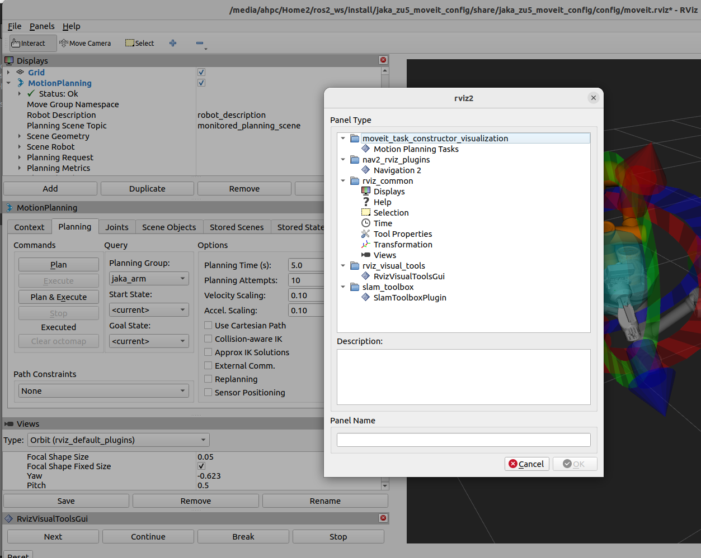
如果单独想打开rviz和movegroup程序打开
ros2 launch jaka_zu5_moveit_config demo.launch.py

## foxy版本运行成功日志
```log
[move_group-3] [INFO] [1744704405.639501774] [moveit_move_group_default_capabilities.move_action_capability]: Received request
[move_group-3] [INFO] [1744704405.639688737] [moveit_move_group_default_capabilities.move_action_capability]: executing..
[move_group-3] [INFO] [1744704405.648343564] [moveit_move_group_default_capabilities.move_action_capability]: Combined planning and execution request received for MoveGroup action. Forwarding to planning and execution pipeline.
[move_group-3] [INFO] [1744704405.648636404] [moveit_ros.plan_execution]: Planning attempt 1 of at most 1
[move_group-3] [INFO] [1744704405.648699697] [moveit_move_group_capabilities_base.move_group_capability]: Using planning pipeline 'move_group'
[move_group-3] [INFO] [1744704405.649565968] [moveit.ompl_planning.model_based_planning_context]: Planner configuration 'jaka_arm' will use planner 'geometric::RRTConnect'. Additional configuration parameters will be set when the planner is constructed.
[move_group-3] [INFO] [1744704405.650184024] [ompl]: /tmp/binarydeb/ros-foxy-ompl-1.5.0/src/ompl/geometric/planners/rrt/src/RRTConnect.cpp:220 - jaka_arm/jaka_arm: Starting planning with 1 states already in datastructure
[move_group-3] [INFO] [1744704405.650207941] [ompl]: /tmp/binarydeb/ros-foxy-ompl-1.5.0/src/ompl/geometric/planners/rrt/src/RRTConnect.cpp:220 - jaka_arm/jaka_arm: Starting planning with 1 states already in datastructure
[move_group-3] [INFO] [1744704405.652468119] [ompl]: /tmp/binarydeb/ros-foxy-ompl-1.5.0/src/ompl/geometric/planners/rrt/src/RRTConnect.cpp:220 - jaka_arm/jaka_arm: Starting planning with 1 states already in datastructure
[move_group-3] [INFO] [1744704405.652524412] [ompl]: /tmp/binarydeb/ros-foxy-ompl-1.5.0/src/ompl/geometric/planners/rrt/src/RRTConnect.cpp:220 - jaka_arm/jaka_arm: Starting planning with 1 states already in datastructure
[move_group-3] [INFO] [1744704405.660933358] [ompl]: /tmp/binarydeb/ros-foxy-ompl-1.5.0/src/ompl/geometric/planners/rrt/src/RRTConnect.cpp:354 - jaka_arm/jaka_arm: Created 4 states (2 start + 2 goal)
[move_group-3] [INFO] [1744704405.662366934] [ompl]: /tmp/binarydeb/ros-foxy-ompl-1.5.0/src/ompl/geometric/planners/rrt/src/RRTConnect.cpp:354 - jaka_arm/jaka_arm: Created 4 states (2 start + 2 goal)
[move_group-3] [INFO] [1744704405.664518900] [ompl]: /tmp/binarydeb/ros-foxy-ompl-1.5.0/src/ompl/geometric/planners/rrt/src/RRTConnect.cpp:354 - jaka_arm/jaka_arm: Created 4 states (2 start + 2 goal)
[move_group-3] [INFO] [1744704405.664867450] [ompl]: /tmp/binarydeb/ros-foxy-ompl-1.5.0/src/ompl/geometric/planners/rrt/src/RRTConnect.cpp:354 - jaka_arm/jaka_arm: Created 4 states (2 start + 2 goal)
[move_group-3] [INFO] [1744704405.665017370] [ompl]: /tmp/binarydeb/ros-foxy-ompl-1.5.0/src/ompl/tools/multiplan/src/ParallelPlan.cpp:135 - ParallelPlan::solve(): Solution found by one or more threads in 0.015072 seconds
[move_group-3] [INFO] [1744704405.665459547] [ompl]: /tmp/binarydeb/ros-foxy-ompl-1.5.0/src/ompl/geometric/planners/rrt/src/RRTConnect.cpp:220 - jaka_arm/jaka_arm: Starting planning with 1 states already in datastructure
[move_group-3] [INFO] [1744704405.665495132] [ompl]: /tmp/binarydeb/ros-foxy-ompl-1.5.0/src/ompl/geometric/planners/rrt/src/RRTConnect.cpp:220 - jaka_arm/jaka_arm: Starting planning with 1 states already in datastructure
[move_group-3] [INFO] [1744704405.666049603] [ompl]: /tmp/binarydeb/ros-foxy-ompl-1.5.0/src/ompl/geometric/planners/rrt/src/RRTConnect.cpp:354 - jaka_arm/jaka_arm: Created 5 states (2 start + 3 goal)
[move_group-3] [INFO] [1744704405.666172689] [ompl]: /tmp/binarydeb/ros-foxy-ompl-1.5.0/src/ompl/geometric/planners/rrt/src/RRTConnect.cpp:354 - jaka_arm/jaka_arm: Created 5 states (2 start + 3 goal)
[move_group-3] [INFO] [1744704405.667794394] [ompl]: /tmp/binarydeb/ros-foxy-ompl-1.5.0/src/ompl/geometric/planners/rrt/src/RRTConnect.cpp:220 - jaka_arm/jaka_arm: Starting planning with 1 states already in datastructure
[move_group-3] [INFO] [1744704405.667861770] [ompl]: /tmp/binarydeb/ros-foxy-ompl-1.5.0/src/ompl/geometric/planners/rrt/src/RRTConnect.cpp:220 - jaka_arm/jaka_arm: Starting planning with 1 states already in datastructure
[move_group-3] [INFO] [1744704405.669696105] [ompl]: /tmp/binarydeb/ros-foxy-ompl-1.5.0/src/ompl/geometric/planners/rrt/src/RRTConnect.cpp:354 - jaka_arm/jaka_arm: Created 4 states (2 start + 2 goal)
[move_group-3] [INFO] [1744704405.670164824] [ompl]: /tmp/binarydeb/ros-foxy-ompl-1.5.0/src/ompl/geometric/planners/rrt/src/RRTConnect.cpp:354 - jaka_arm/jaka_arm: Created 5 states (3 start + 2 goal)
[move_group-3] [INFO] [1744704405.670344787] [ompl]: /tmp/binarydeb/ros-foxy-ompl-1.5.0/src/ompl/tools/multiplan/src/ParallelPlan.cpp:135 - ParallelPlan::solve(): Solution found by one or more threads in 0.005056 seconds
[move_group-3] [INFO] [1744704405.670586876] [ompl]: /tmp/binarydeb/ros-foxy-ompl-1.5.0/src/ompl/geometric/planners/rrt/src/RRTConnect.cpp:220 - jaka_arm/jaka_arm: Starting planning with 1 states already in datastructure
[move_group-3] [INFO] [1744704405.670623918] [ompl]: /tmp/binarydeb/ros-foxy-ompl-1.5.0/src/ompl/geometric/planners/rrt/src/RRTConnect.cpp:220 - jaka_arm/jaka_arm: Starting planning with 1 states already in datastructure
[move_group-3] [INFO] [1744704405.671166723] [ompl]: /tmp/binarydeb/ros-foxy-ompl-1.5.0/src/ompl/geometric/planners/rrt/src/RRTConnect.cpp:354 - jaka_arm/jaka_arm: Created 5 states (2 start + 3 goal)
[move_group-3] [INFO] [1744704405.672772968] [ompl]: /tmp/binarydeb/ros-foxy-ompl-1.5.0/src/ompl/geometric/planners/rrt/src/RRTConnect.cpp:354 - jaka_arm/jaka_arm: Created 5 states (2 start + 3 goal)
[move_group-3] [INFO] [1744704405.672982973] [ompl]: /tmp/binarydeb/ros-foxy-ompl-1.5.0/src/ompl/tools/multiplan/src/ParallelPlan.cpp:135 - ParallelPlan::solve(): Solution found by one or more threads in 0.002515 seconds
[move_group-3] [INFO] [1744704405.680462648] [ompl]: /tmp/binarydeb/ros-foxy-ompl-1.5.0/src/ompl/geometric/src/SimpleSetup.cpp:179 - SimpleSetup: Path simplification took 0.007390 seconds and changed from 3 to 2 states
[move_group-3] [INFO] [1744704405.686061321] [moveit_ros.trajectory_execution_manager]: Validating trajectory with allowed_start_tolerance 0.001
[move_group-3] [INFO] [1744704405.688002408] [moveit_ros.trajectory_execution_manager]: Starting trajectory execution ...
[move_group-3] [INFO] [1744704405.688103035] [moveit.simple_controller_manager.follow_joint_trajectory_controller_handle]: sending trajectory to jaka_arm_controller
[move_group-3] [INFO] [1744704405.689218103] [moveit.simple_controller_manager.follow_joint_trajectory_controller_handle]: jaka_arm_controller started execution
[move_group-3] [INFO] [1744704405.689250187] [moveit.simple_controller_manager.follow_joint_trajectory_controller_handle]: Goal request accepted!
[rviz2-1] [INFO] [1744704405.939802086] [move_group_interface]: Plan and Execute request accepted
[move_group-3] [INFO] [1744704407.644389150] [moveit.simple_controller_manager.follow_joint_trajectory_controller_handle]: Controller jaka_arm_controller successfully finished
[move_group-3] [INFO] [1744704407.663883147] [moveit_ros.trajectory_execution_manager]: Completed trajectory execution with status SUCCEEDED ...
[move_group-3] [INFO] [1744704407.668175414] [moveit_move_group_default_capabilities.move_action_capability]: Solution was found and executed.
[rviz2-1] [INFO] [1744704407.943936643] [move_group_interface]: Plan and Execute request complete!


[move_group-3] [INFO] [1744704491.765415619] [moveit_move_group_default_capabilities.move_action_capability]: Received request
[move_group-3] [INFO] [1744704491.765622707] [moveit_move_group_default_capabilities.move_action_capability]: executing..
[move_group-3] [INFO] [1744704491.770048847] [moveit_move_group_default_capabilities.move_action_capability]: Planning request received for MoveGroup action. Forwarding to planning pipeline.
[move_group-3] [INFO] [1744704491.770114765] [moveit_move_group_capabilities_base.move_group_capability]: Using planning pipeline 'move_group'
[move_group-3] [INFO] [1744704491.771000868] [moveit.ompl_planning.model_based_planning_context]: Planner configuration 'jaka_arm[RRTstarkConfigDefault]' will use planner 'geometric::RRTstar'. Additional configuration parameters will be set when the planner is constructed.
[move_group-3] [INFO] [1744704491.771597631] [ompl]: /tmp/binarydeb/ros-foxy-ompl-1.5.0/src/ompl/geometric/planners/rrt/src/RRTstar.cpp:119 - jaka_arm/jaka_arm[RRTstarkConfigDefault]: No optimization objective specified. Defaulting to optimizing path length for the allowed planning time.
[move_group-3] [INFO] [1744704491.772306688] [ompl]: /tmp/binarydeb/ros-foxy-ompl-1.5.0/src/ompl/geometric/planners/rrt/src/RRTstar.cpp:203 - jaka_arm/jaka_arm[RRTstarkConfigDefault]: Started planning with 1 states. Seeking a solution better than 0.00000.
[move_group-3] [INFO] [1744704491.772324772] [ompl]: /tmp/binarydeb/ros-foxy-ompl-1.5.0/src/ompl/geometric/planners/rrt/src/RRTstar.cpp:236 - jaka_arm/jaka_arm[RRTstarkConfigDefault]: Initial k-nearest value of 310
[move_group-3] [INFO] [1744704491.772359481] [ompl]: /tmp/binarydeb/ros-foxy-ompl-1.5.0/src/ompl/geometric/planners/rrt/src/RRTstar.cpp:203 - jaka_arm/jaka_arm[RRTstarkConfigDefault]: Started planning with 1 states. Seeking a solution better than 0.00000.
[move_group-3] [INFO] [1744704491.772505026] [ompl]: /tmp/binarydeb/ros-foxy-ompl-1.5.0/src/ompl/geometric/planners/rrt/src/RRTstar.cpp:236 - jaka_arm/jaka_arm[RRTstarkConfigDefault]: Initial k-nearest value of 310
[move_group-3] [INFO] [1744704491.772572694] [ompl]: /tmp/binarydeb/ros-foxy-ompl-1.5.0/src/ompl/geometric/planners/rrt/src/RRTstar.cpp:203 - jaka_arm/jaka_arm[RRTstarkConfigDefault]: Started planning with 1 states. Seeking a solution better than 0.00000.
[move_group-3] [INFO] [1744704491.772621404] [ompl]: /tmp/binarydeb/ros-foxy-ompl-1.5.0/src/ompl/geometric/planners/rrt/src/RRTstar.cpp:236 - jaka_arm/jaka_arm[RRTstarkConfigDefault]: Initial k-nearest value of 310
[move_group-3] [INFO] [1744704491.772652613] [ompl]: /tmp/binarydeb/ros-foxy-ompl-1.5.0/src/ompl/geometric/planners/rrt/src/RRTstar.cpp:203 - jaka_arm/jaka_arm[RRTstarkConfigDefault]: Started planning with 1 states. Seeking a solution better than 0.00000.
[move_group-3] [INFO] [1744704491.772673030] [ompl]: /tmp/binarydeb/ros-foxy-ompl-1.5.0/src/ompl/geometric/planners/rrt/src/RRTstar.cpp:236 - jaka_arm/jaka_arm[RRTstarkConfigDefault]: Initial k-nearest value of 310
[move_group-3] [INFO] [1744704491.785515397] [ompl]: /tmp/binarydeb/ros-foxy-ompl-1.5.0/src/ompl/geometric/planners/rrt/src/RRTstar.cpp:480 - jaka_arm/jaka_arm[RRTstarkConfigDefault]: Found an initial solution with a cost of 0.70 in 43 iterations (33 vertices in the graph)
[move_group-3] [INFO] [1744704491.795403408] [ompl]: /tmp/binarydeb/ros-foxy-ompl-1.5.0/src/ompl/geometric/planners/rrt/src/RRTstar.cpp:480 - jaka_arm/jaka_arm[RRTstarkConfigDefault]: Found an initial solution with a cost of 0.70 in 29 iterations (23 vertices in the graph)
[move_group-3] [INFO] [1744704491.808057938] [ompl]: /tmp/binarydeb/ros-foxy-ompl-1.5.0/src/ompl/geometric/planners/rrt/src/RRTstar.cpp:480 - jaka_arm/jaka_arm[RRTstarkConfigDefault]: Found an initial solution with a cost of 0.70 in 44 iterations (25 vertices in the graph)
[move_group-3] [INFO] [1744704491.808579158] [ompl]: /tmp/binarydeb/ros-foxy-ompl-1.5.0/src/ompl/geometric/planners/rrt/src/RRTstar.cpp:480 - jaka_arm/jaka_arm[RRTstarkConfigDefault]: Found an initial solution with a cost of 0.70 in 78 iterations (59 vertices in the graph)
[rviz2-1] [INFO] [1744704492.065924978] [move_group_interface]: Planning request accepted
[move_group-3] [INFO] [1744704496.771929745] [ompl]: /tmp/binarydeb/ros-foxy-ompl-1.5.0/src/ompl/geometric/planners/rrt/src/RRTstar.cpp:595 - jaka_arm/jaka_arm[RRTstarkConfigDefault]: Created 3589 new states. Checked 6442255 rewire options. 10 goal states in tree. Final solution cost 0.698
[move_group-3] [INFO] [1744704496.772087540] [ompl]: /tmp/binarydeb/ros-foxy-ompl-1.5.0/src/ompl/geometric/planners/rrt/src/RRTstar.cpp:595 - jaka_arm/jaka_arm[RRTstarkConfigDefault]: Created 3523 new states. Checked 6207526 rewire options. 10 goal states in tree. Final solution cost 0.698
[move_group-3] [INFO] [1744704496.773495447] [ompl]: /tmp/binarydeb/ros-foxy-ompl-1.5.0/src/ompl/geometric/planners/rrt/src/RRTstar.cpp:595 - jaka_arm/jaka_arm[RRTstarkConfigDefault]: Created 3397 new states. Checked 5771503 rewire options. 10 goal states in tree. Final solution cost 0.698
[move_group-3] [INFO] [1744704496.774198962] [ompl]: /tmp/binarydeb/ros-foxy-ompl-1.5.0/src/ompl/geometric/planners/rrt/src/RRTstar.cpp:595 - jaka_arm/jaka_arm[RRTstarkConfigDefault]: Created 3496 new states. Checked 6112756 rewire options. 10 goal states in tree. Final solution cost 0.698
[move_group-3] [INFO] [1744704496.774320298] [ompl]: /tmp/binarydeb/ros-foxy-ompl-1.5.0/src/ompl/tools/multiplan/src/ParallelPlan.cpp:135 - ParallelPlan::solve(): Solution found by one or more threads in 5.002265 seconds
[move_group-3] [INFO] [1744704496.774548970] [ompl]: /tmp/binarydeb/ros-foxy-ompl-1.5.0/src/ompl/geometric/src/SimpleSetup.cpp:179 - SimpleSetup: Path simplification took 0.000126 seconds and changed from 2 to 2 states
[move_group-3] [INFO] [1744704496.778464390] [moveit_move_group_default_capabilities.move_action_capability]: Motion plan was computed succesfully.
[rviz2-1] [INFO] [1744704497.077427569] [move_group_interface]: Planning request complete!
[rviz2-1] [INFO] [1744704497.177658988] [move_group_interface]: time taken to generate plan: 5.00279 seconds


[move_group-3] [INFO] [1744943999.222171676] [moveit_move_group_default_capabilities.move_action_capability]: Received request
[move_group-3] [INFO] [1744943999.222345219] [moveit_move_group_default_capabilities.move_action_capability]: executing..
[move_group-3] [INFO] [1744943999.230292029] [moveit_move_group_default_capabilities.move_action_capability]: Combined planning and execution request received for MoveGroup action. Forwarding to planning and execution pipeline.
[move_group-3] [INFO] [1744943999.230511947] [moveit_ros.plan_execution]: Planning attempt 1 of at most 1
[move_group-3] [INFO] [1744943999.230557447] [moveit_move_group_capabilities_base.move_group_capability]: Using planning pipeline 'move_group'
[move_group-3] [INFO] [1744943999.231661414] [moveit.ompl_planning.model_based_planning_context]: Planner configuration 'jaka_arm[RRTkConfigDefault]' will use planner 'geometric::RRT'. Additional configuration parameters will be set when the planner is constructed.
[move_group-3] [INFO] [1744943999.232421212] [ompl]: /tmp/binarydeb/ros-foxy-ompl-1.5.0/src/ompl/geometric/planners/rrt/src/RRT.cpp:119 - jaka_arm/jaka_arm[RRTkConfigDefault]: Starting planning with 1 states already in datastructure
[move_group-3] [INFO] [1744943999.232449503] [ompl]: /tmp/binarydeb/ros-foxy-ompl-1.5.0/src/ompl/geometric/planners/rrt/src/RRT.cpp:119 - jaka_arm/jaka_arm[RRTkConfigDefault]: Starting planning with 1 states already in datastructure
[move_group-3] [INFO] [1744943999.232476045] [ompl]: /tmp/binarydeb/ros-foxy-ompl-1.5.0/src/ompl/geometric/planners/rrt/src/RRT.cpp:119 - jaka_arm/jaka_arm[RRTkConfigDefault]: Starting planning with 1 states already in datastructure
[move_group-3] [INFO] [1744943999.240376188] [ompl]: /tmp/binarydeb/ros-foxy-ompl-1.5.0/src/ompl/geometric/planners/rrt/src/RRT.cpp:119 - jaka_arm/jaka_arm[RRTkConfigDefault]: Starting planning with 1 states already in datastructure
[move_group-3] [INFO] [1744943999.244116258] [ompl]: /tmp/binarydeb/ros-foxy-ompl-1.5.0/src/ompl/geometric/planners/rrt/src/RRT.cpp:227 - jaka_arm/jaka_arm[RRTkConfigDefault]: Created 13 states
[move_group-3] [INFO] [1744943999.247670534] [ompl]: /tmp/binarydeb/ros-foxy-ompl-1.5.0/src/ompl/geometric/planners/rrt/src/RRT.cpp:227 - jaka_arm/jaka_arm[RRTkConfigDefault]: Created 54 states
[move_group-3] [INFO] [1744943999.250088178] [ompl]: /tmp/binarydeb/ros-foxy-ompl-1.5.0/src/ompl/geometric/planners/rrt/src/RRT.cpp:227 - jaka_arm/jaka_arm[RRTkConfigDefault]: Created 17 states
[move_group-3] [INFO] [1744943999.251163852] [ompl]: /tmp/binarydeb/ros-foxy-ompl-1.5.0/src/ompl/geometric/planners/rrt/src/RRT.cpp:227 - jaka_arm/jaka_arm[RRTkConfigDefault]: Created 69 states
[move_group-3] [INFO] [1744943999.251251353] [ompl]: /tmp/binarydeb/ros-foxy-ompl-1.5.0/src/ompl/tools/multiplan/src/ParallelPlan.cpp:135 - ParallelPlan::solve(): Solution found by one or more threads in 0.019054 seconds
[move_group-3] [INFO] [1744943999.251752732] [ompl]: /tmp/binarydeb/ros-foxy-ompl-1.5.0/src/ompl/geometric/planners/rrt/src/RRT.cpp:119 - jaka_arm/jaka_arm[RRTkConfigDefault]: Starting planning with 1 states already in datastructure
[move_group-3] [INFO] [1744943999.251773149] [ompl]: /tmp/binarydeb/ros-foxy-ompl-1.5.0/src/ompl/geometric/planners/rrt/src/RRT.cpp:119 - jaka_arm/jaka_arm[RRTkConfigDefault]: Starting planning with 1 states already in datastructure
[move_group-3] [INFO] [1744943999.251865316] [ompl]: /tmp/binarydeb/ros-foxy-ompl-1.5.0/src/ompl/geometric/planners/rrt/src/RRT.cpp:119 - jaka_arm/jaka_arm[RRTkConfigDefault]: Starting planning with 1 states already in datastructure
[move_group-3] [INFO] [1744943999.251883108] [ompl]: /tmp/binarydeb/ros-foxy-ompl-1.5.0/src/ompl/geometric/planners/rrt/src/RRT.cpp:119 - jaka_arm/jaka_arm[RRTkConfigDefault]: Starting planning with 1 states already in datastructure
[move_group-3] [INFO] [1744943999.254254376] [ompl]: /tmp/binarydeb/ros-foxy-ompl-1.5.0/src/ompl/geometric/planners/rrt/src/RRT.cpp:227 - jaka_arm/jaka_arm[RRTkConfigDefault]: Created 10 states
[move_group-3] [INFO] [1744943999.254664754] [ompl]: /tmp/binarydeb/ros-foxy-ompl-1.5.0/src/ompl/geometric/planners/rrt/src/RRT.cpp:227 - jaka_arm/jaka_arm[RRTkConfigDefault]: Created 9 states
[move_group-3] [INFO] [1744943999.257549067] [ompl]: /tmp/binarydeb/ros-foxy-ompl-1.5.0/src/ompl/geometric/planners/rrt/src/RRT.cpp:227 - jaka_arm/jaka_arm[RRTkConfigDefault]: Created 21 states
[move_group-3] [INFO] [1744943999.263239526] [ompl]: /tmp/binarydeb/ros-foxy-ompl-1.5.0/src/ompl/geometric/planners/rrt/src/RRT.cpp:227 - jaka_arm/jaka_arm[RRTkConfigDefault]: Created 34 states
[move_group-3] [INFO] [1744943999.263316527] [ompl]: /tmp/binarydeb/ros-foxy-ompl-1.5.0/src/ompl/tools/multiplan/src/ParallelPlan.cpp:135 - ParallelPlan::solve(): Solution found by one or more threads in 0.011691 seconds
[move_group-3] [INFO] [1744943999.263498820] [ompl]: /tmp/binarydeb/ros-foxy-ompl-1.5.0/src/ompl/geometric/planners/rrt/src/RRT.cpp:119 - jaka_arm/jaka_arm[RRTkConfigDefault]: Starting planning with 1 states already in datastructure
[move_group-3] [INFO] [1744943999.263537320] [ompl]: /tmp/binarydeb/ros-foxy-ompl-1.5.0/src/ompl/geometric/planners/rrt/src/RRT.cpp:119 - jaka_arm/jaka_arm[RRTkConfigDefault]: Starting planning with 1 states already in datastructure
[move_group-3] [INFO] [1744943999.269572241] [ompl]: /tmp/binarydeb/ros-foxy-ompl-1.5.0/src/ompl/geometric/planners/rrt/src/RRT.cpp:227 - jaka_arm/jaka_arm[RRTkConfigDefault]: Created 8 states
[move_group-3] [INFO] [1744943999.275450243] [ompl]: /tmp/binarydeb/ros-foxy-ompl-1.5.0/src/ompl/geometric/planners/rrt/src/RRT.cpp:227 - jaka_arm/jaka_arm[RRTkConfigDefault]: Created 50 states
[move_group-3] [INFO] [1744943999.275564286] [ompl]: /tmp/binarydeb/ros-foxy-ompl-1.5.0/src/ompl/tools/multiplan/src/ParallelPlan.cpp:135 - ParallelPlan::solve(): Solution found by one or more threads in 0.012134 seconds
[move_group-3] [INFO] [1744943999.275667537] [ompl]: /tmp/binarydeb/ros-foxy-ompl-1.5.0/src/ompl/geometric/src/SimpleSetup.cpp:179 - SimpleSetup: Path simplification took 0.000003 seconds and changed from 2 to 2 states
[move_group-3] [INFO] [1744943999.279240772] [moveit_ros.trajectory_execution_manager]: Validating trajectory with allowed_start_tolerance 0.001
[move_group-3] [INFO] [1744943999.280992535] [moveit_ros.trajectory_execution_manager]: Starting trajectory execution ...
[move_group-3] [INFO] [1744943999.281082369] [moveit.simple_controller_manager.follow_joint_trajectory_controller_handle]: sending trajectory to jaka_arm_controller
[move_group-3] [INFO] [1744943999.282191586] [moveit.simple_controller_manager.follow_joint_trajectory_controller_handle]: jaka_arm_controller started execution
[move_group-3] [INFO] [1744943999.282205002] [moveit.simple_controller_manager.follow_joint_trajectory_controller_handle]: Goal request accepted!
[rviz2-1] [INFO] [1744943999.522450891] [move_group_interface]: Plan and Execute request accepted
[move_group-3] [WARN] [1744944000.872688714] [moveit.simple_controller_manager.follow_joint_trajectory_controller_handle]: waitForExecution timed out
[move_group-3] [ERROR] [1744944000.872775048] [moveit_ros.trajectory_execution_manager]: Controller is taking too long to execute trajectory (the expected upper bound for the trajectory execution was 1.590320 seconds). Stopping trajectory.
[move_group-3] [INFO] [1744944000.872824340] [moveit.simple_controller_manager.follow_joint_trajectory_controller_handle]: Cancelling execution for jaka_arm_controller
[move_group-3] [INFO] [1744944001.042081822] [moveit_ros.trajectory_execution_manager]: Completed trajectory execution with status TIMED_OUT ...
[move_group-3] [INFO] [1744944001.042431533] [moveit.simple_controller_manager.follow_joint_trajectory_controller_handle]: Controller jaka_arm_controller successfully finished
[move_group-3] [INFO] [1744944001.051117432] [moveit_move_group_default_capabilities.move_action_capability]: Timeout reached
[rviz2-1] [INFO] [1744944001.325939211] [move_group_interface]: Plan and Execute request aborted
[rviz2-1] [ERROR] [1744944001.426199799] [move_group_interface]: MoveGroupInterface::move() failed or timeout reached

```      
出现Controller is taking too long to execute trajectory (the expected upper bound for the trajectory execution was 1.590320 seconds). Stopping trajectory超时的错误，需要修改以下两个参数来调整超时时间    
allowed_goal_duration_margin: 1.5
allowed_execution_duration_scaling: 1.1
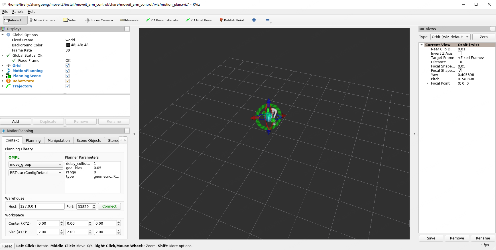
## 发展历程
MoveIt 2 是 MoveIt 的下一代版本，基于 ROS 2 开发，解决了 ROS 1 中的一些局限性，并增加了对新技术的支持。ROS 2 本身的推出使得 MoveIt 2 可以充分利用 ROS 2 的实时性、安全性和分布式通信能力，从而提升了机器人系统的性能和可靠性。

2019年：MoveIt 2 的开发正式开始，并且第一版的 MoveIt 2 在 ROS 2 环境下发布。与 ROS 1 版本相比，MoveIt 2 对性能和稳定性做出了大幅优化，能够支持更复杂的机器人任务。

2020年：MoveIt 2 在 ROS 2 下的功能逐步完善，包括支持实时通信、增强的多机器人协作、改进的碰撞检测和路径规划等。同时，MoveIt 2 加强了对工业机器人平台的支持，并进一步改进了对传感器数据和环境感知的整合。

2021年：MoveIt 2 推出了更多针对工业应用的改进，如与工业机器人控制器的更好集成，以及支持多种传感器（激光雷达、相机等）信息的融合。
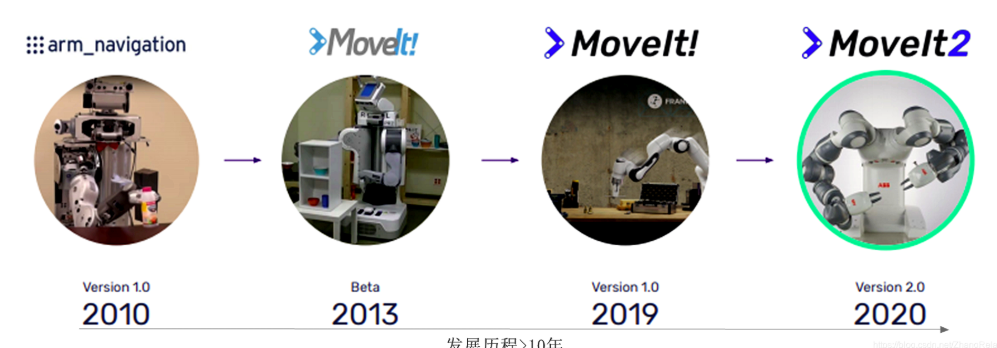
### 主要的功能
1. 运动规划（Motion Planning）
多种运动规划算法：MoveIt 2 支持多个运动规划算法，包括 RRT (Rapidly-exploring Random Tree)、PRM (Probabilistic Roadmap)、STOMP、CHOMP 等。
自定义规划：用户可以根据需求自定义运动规划的算法和配置。
逆向运动学 (IK)：提供求解机器人的逆向运动学问题的功能，确保机器臂末端执行器能够到达目标位置。
全局与局部规划：MoveIt 2 支持全局路径规划与局部轨迹生成，适应不同的应用场景。
2. 碰撞检测与环境建模
碰撞检测：MoveIt 2 提供高效的碰撞检测机制，确保机器人的路径不会与环境中的障碍物发生冲突。其碰撞检测模块能够与环境建模系统（如传感器数据）无缝集成。
环境感知与建模：MoveIt 2 能够实时获取来自传感器（例如激光雷达、深度相机、RGBD 相机等）的数据，通过集成这些信息生成环境模型，并动态更新环境地图。
接触建模：支持对机器人与环境接触的建模和模拟，进行实时的接触力分析。
3. 路径优化
轨迹优化：MoveIt 2 提供路径后处理功能，优化生成的路径以减少能量消耗、避开障碍物，或尽可能提高运动平滑度。
时间参数化：通过时间参数化技术优化轨迹中的时间分配，使得机器人在执行路径时具有更高的效率和更好的稳定性。
4. 多种机器人控制与集成
多机器人支持：MoveIt 2 能够控制多个机器人，支持 多机器人协调、任务分配 和 协作控制。
硬件接口：MoveIt 2 支持多种机器人平台的硬件接口，包括工业机器人（如 KUKA、ABB、UR）、移动平台（如 TurtleBot、移动机械臂）等。通过 ROS 2 的硬件接口（ros2_control），MoveIt 2 可以与机器人硬件控制器进行精确的协作。
传感器集成：MoveIt 2 支持传感器数据的集成，如视觉、激光雷达、力矩传感器等，用于提升运动规划的智能化和环境感知能力。
5. 逆向运动学和正向运动学
自定义逆向运动学求解器：MoveIt 2 提供了多个逆向运动学求解器，支持自定义配置和添加新的求解器。
多链逆向运动学：支持同时对多个运动链（例如多自由度的机械臂）进行逆向运动学求解。
正向运动学：MoveIt 2 通过精确的正向运动学求解器来计算机器人的姿态和位置。
6. 视觉感知和图像处理
视觉输入支持：MoveIt 2 可以从相机传感器获取图像数据，通过集成视觉处理算法，进行物体检测、定位、姿态估计等任务。
物体抓取：通过与视觉感知系统的结合，MoveIt 2 可以实现基于视觉的抓取任务。它能够感知物体的位姿，并进行相应的路径规划与抓取动作。
7. 实时控制与反馈
实时性能：MoveIt 2 支持实时控制，特别是在 ROS 2 环境下，利用 ROS 2 的 实时调度 和 实时通信机制，实现更高效的机器人控制。
动态反馈：MoveIt 2 可以基于机器人和环境的实时反馈调整运动轨迹，避免碰撞并优化任务执行过程。
8. 集成与可扩展性
与 ROS 2 的紧密集成：MoveIt 2 完全兼容 ROS 2，利用 ROS 2 的分布式架构、实时调度和通信机制，实现多机器人协作、机器人云端控制等复杂任务。
插件化设计：MoveIt 2 提供了插件化架构，允许用户根据实际需求选择或开发新的功能插件。这包括规划算法、控制接口、感知模块等。
9. 可视化与调试工具
Rviz 可视化：MoveIt 2 与 ROS 2 中的 Rviz 可视化工具集成，支持机器人运动轨迹的实时展示、调试与可视化。
MoveIt 2 Setup Assistant：MoveIt 2 提供了 Setup Assistant 工具，使用户可以快速配置机器人模型、规划组、传感器数据、规划场景等。

***
## Moveit2代码框架及[概念](https://moveit.picknik.ai/main/doc/concepts/concepts.html)
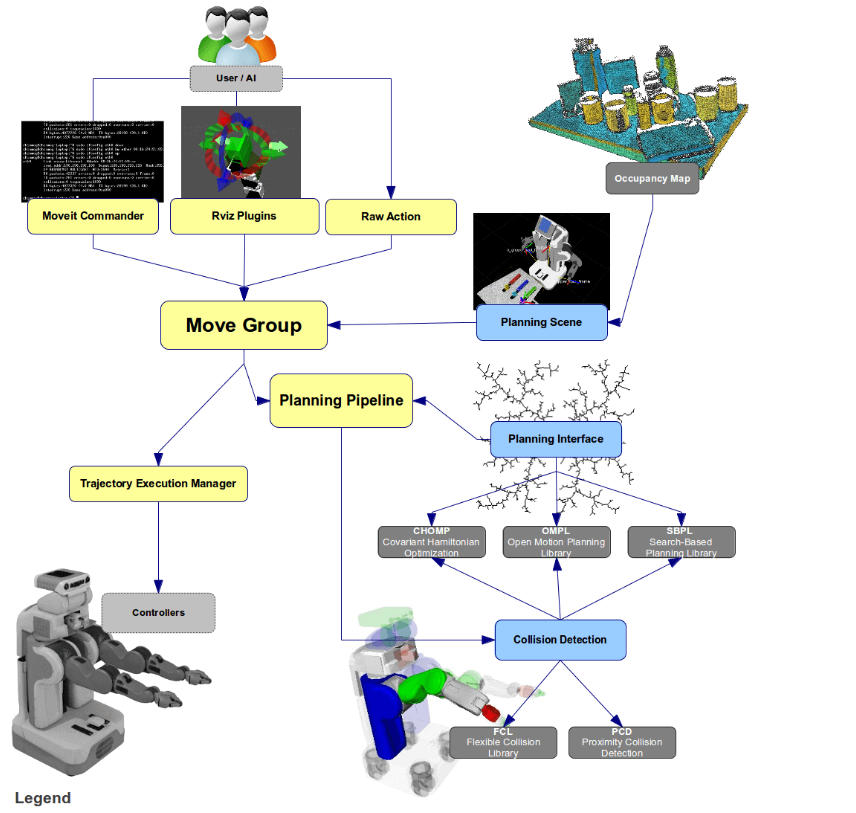

### 规划接口  
MoveIt 2 中支持多种规划器，[PlanningPipeline](./moveit2/moveit_ros/planning/planning_pipeline/src/planning_pipeline.cpp) 充当了一个统一接口，使用户可以方便地选择和切换规划器，而无需修改代码逻辑。  
1. 接收用户的运动规划请求（通常由 MotionPlanRequest 表示）。
2. 调用具体的路径规划器（如 OMPL、CHOMP 等）。
3. 执行后处理步骤（如平滑轨迹、验证路径可行性）。
Moveit2提供四个默认的规划流水线的实现：
1. 基于开源运动规划库的规划器OMPL（Open Motion Planning Library）[ompl_interface.cpp](./moveit2/moveit_planners/ompl/ompl_interface/src/ompl_interface.cpp)
2. 基于搜索的规划器SBPL（Search-Based Planning Library）
3. 基于梯度轨迹优化的协变哈密顿量优化规划器CHOMP（Covariant Hamiltonian Optimization for Motion Planning）[chomp_interface.cpp](./moveit2/moveit_planners/chomp/chomp_interface/src/chomp_interface.cpp)
4. PIMP 是一种专注于工业机器人的运动规划器（Pilz Industrial Motion Planner）[pilz_industrial_motion_planner.cpp](./moveit2/moveit_planners/pilz_industrial_motion_planner/src/pilz_industrial_motion_planner.cpp)
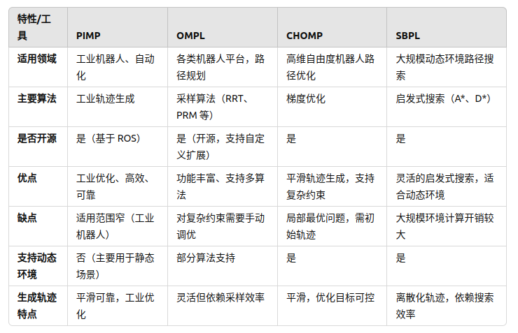  
PIMP：适合工业机器人场景，如自动化生产线，需要高效、安全、工业标准的路径规划。
OMPL：适合广泛的研究和工程项目，尤其是机器人领域的通用路径规划任务。
CHOMP：适合高自由度、高精度要求的路径规划问题，尤其是在复杂环境下的轨迹优化。
SBPL：适合动态和大规模环境中的路径规划，尤其是基于离散搜索的方法。

### 碰撞检测
Moveit2提供了两种实现：
基于FCL(Flexible Collision Library)库实现的碰撞检测[collision_detector_fcl_plugin_loader.cpp](./moveit2/moveit_core/collision_detection_fcl/src/collision_detector_fcl_plugin_loader.cpp)。
源码中没看到PCD,只看到了Bullet碰撞检测[collision_detector_bullet_plugin_loader.cpp](./moveit2/moveit_core/collision_detection_bullet/src/collision_detector_bullet_plugin_loader.cpp)
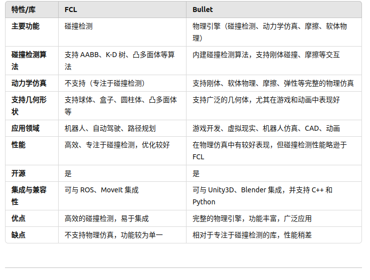    
MoveIt 中的碰撞检查主要使用FCL，MoveIt 支持不同类型物体的碰撞检查：[collision_common.cpp](./moveit2/moveit_core/collision_detection/src/collision_common.cpp)
1.  网格- 您可以使用.stl（标准三角语言）或.dae（数字资产交换）格式来描述机器人链接等对象。
2.  原始形状- 例如盒子、圆柱体、圆锥体、球体和平面  
3.  Octomap-该Octomap对象可直接用于碰撞检查
 
对于自碰撞 使用Allowed Collision Matrix (ACM)，如果两个物体总是相距很远以至于它们永远不会相互碰撞，则不需要碰撞检查 
## 运动学（Kinematics）
MoveIt 的默认逆运动学插件是使用KDL基于雅可比矩阵的数值求解器配置的[kinematics_base.cpp](./moveit2/moveit_core/kinematics_base/src/kinematics_base.cpp) ，可在Setup Assistant进行模型配置时，可以进行配置。
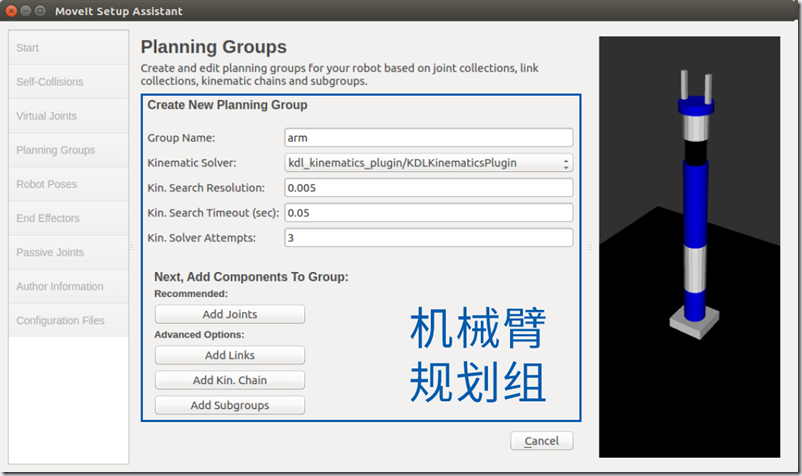     
配置完成后，就可以运行demo.launch控制虚拟机械臂进行运动规划了。但是KDL有自己的优缺点：
## 运动规划（Motion Planning）
运动规划器的接口是通过 ROS 操作或服务（由节点提供move_group）实现的，move_group 的默认运动规划器使用 OMPL 和 MoveIt 接口（由 MoveIt 设置助手配置）配置。默认情况下可用的其他规划器包括 Pilz 工业运动规划器和 CHOMP
### 运动规划请求
要求运动规划器将手臂移动到其他位置（在关节空间中）或将末端执行器移动到新姿势。运动规划器要检查的约束，MoveIt 提供的内置约束是：[kinematic_constraint.cpp](./moveit2/moveit_core/kinematic_constraints/src/kinematic_constraint.cpp)
1. 位置约束：将链接的位置限制在空间某个区域内。 
2. 方向约束：限制链接的方向在指定的滚动、俯仰或偏航限制范围内。
3. 可见性约束：限制链接上的点位于特定传感器的可见性锥体内。
4. 关节约束：限制关节位于两个值之间。
5. 用户指定的约束：也可以使用用户定义的回调指定自己的约束。   
### 运动规划应答   
move_group节点将根据您的运动计划请求生成所需轨迹。此轨迹将使手臂（或任何关节组）移动到所需位置。请注意，move_group产生的结果是轨迹，而不仅仅是路径。move_group 将使用所需的最大速度和加速度（如果指定）来生成遵循关节级速度和加速度约束的轨迹。
### 运动规划请求适配器[planning_request_adapter.cpp](./moveit2/moveit_core/planning_request_adapter/src/planning_request_adapter.cpp)
规划请求适配器允许预处理运动规划请求和后处理运动规划响应。预处理在几种情况下很有用，例如当机器人的起始状态略微超出机器人指定的关节限制时。其他几个操作需要后处理，例如将为机器人生成的路径转换为时间参数化的轨迹。MoveIt 提供了一组默认的运动规划适配器，每个适配器都执行非常具体的功能。
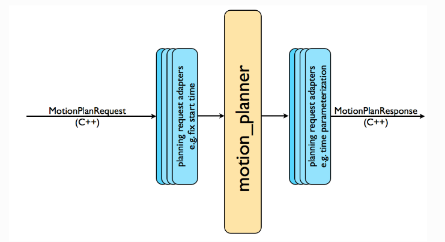   
### 检查开始状态边界 （CheckStartStateBounds）  
在这种情况下，运动规划器无法进行规划，因为它会认为起始状态超出了关节限制。 “CheckStartStateBounds”规划请求适配器将通过将起始状态移动到关节限制来“修复”起始状态。  
### 验证工作空间边界 （ValidateWorkspaceBounds）   
固定工作区边界适配器将指定一个用于规划的默认工作区：一个尺寸为 10 米 x 10 米 x 10 米的立方体。仅当规划人员的规划请求未填写这些字段时，才会指定此工作区
### 检查启动状态碰撞 （CheckStartStateCollision）  
修复启动状态碰撞适配器将尝试通过对关节值进行少量扰动来采样指定配置（碰撞中）附近的新无碰撞配置。扰动值的量由jiggle_fraction参数指定，该参数控制扰动占关节总运动范围的百分比。   
### 添加时间参数化（AddTimeParameterization）
运动规划器通常会生成“运动路径”，即不遵循任何速度或加速度约束且不进行时间参数化的路径。此适配器将通过应用速度和加速度约束来“时间参数化”运动规划。   
### 解析约束帧（ResolveConstraintFrames）   
可以使用子帧设置目标约束，（例如，帧中的姿势目标cup/handle，其中handle是对象上的子帧cup）。此适配器将约束框架更改为对象或机器人帧（例如cup）。   
## 混合规划（Hybrid Planning）[hybrid_planning_manager.cpp](./moveit2/moveit_ros/hybrid_planning/hybrid_planning_manager/hybrid_planning_manager_component/src/hybrid_planning_manager.cpp) 
MoveIt 的运动规划架构遵循“感知-规划-执行”方法。为了规划和执行运动，首先感知环境和机器人状态（“感知”），然后规划器计算机器人轨迹（“规划”），最后使用轨迹控制器一次性执行（“执行”）。   
MoveIt 的混合规划架构结合了一对全局和局部规划器，它们并行且循环运行，具有不同的规划速度和问题范围。   
### 全局规划 (Global Planning) [global_planner_component.cpp](./moveit2/moveit_ros/hybrid_planning/global_planner/global_planner_component/src/global_planner_component.cpp) 
全局规划 是在整个工作空间中寻找一条从起始状态到目标状态的可行路径。

目标：生成一条避开所有障碍物、满足约束条件的全局最优或次优路径。
范围：规划范围涵盖整个工作空间，包括所有已知的静态障碍物和可能的动态障碍物。
输入：
机器人初始状态（关节角或末端位姿）。
目标状态（关节角或末端位姿）。
环境模型（通常由 3D 地图或场景信息定义）。
输出：一条从起始状态到目标状态的全局路径，路径可能由离散点序列或控制命令组成。
典型算法：如 RRT（快速随机树）、PRM（概率路图）、OMPL 库中的多种采样基路径规划算法。    
### 局部规划 (Local Planning)[local_planner_component.cpp](./moveit2/moveit_ros/hybrid_planning/local_planner/local_planner_component/src/local_planner_component.cpp)
局部规划 是在全局规划提供的路径或局部区域中生成机器人执行运动的实际控制命令。

目标：优化局部路径，生成符合实时性需求的轨迹，同时处理动态环境和运动约束。
范围：规划范围仅限于机器人附近的局部区域，或者在全局路径的局部子段上进行微调。
输入：
全局路径的局部片段。
机器人当前状态。
局部障碍物信息（通常通过传感器实时感知）。
输出：一段平滑的轨迹或一组控制命令（速度、加速度等）。
典型算法：如 DWA（动态窗口算法）、CHOMP（Covariant Hamiltonian Optimization for Motion Planning）、轨迹优化方法（如 STOMP）。
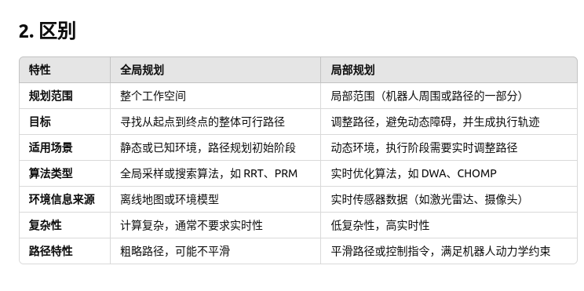
### 混合规划架构 （The Hybrid Planning Architecture）  
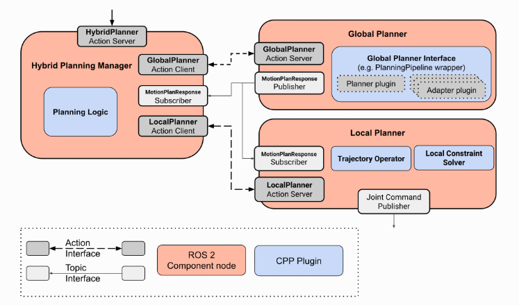  
架构组件设计为通用且高度可定制。由于组件仅通过 ROS 2 消息接口进行交互，因此很容易替换架构的每个组件或插件的实现。插件接口设计为最小，并尽可能从实际算法实现中抽象出来。这使开发人员可以完全专注于隔离的逻辑或求解器，而无需实现基础架构的任何部分。这还允许将相同的组件重复用于不同的设置或规划问题。
#### 混合规划管理器 （Hybrid Planning Manager）  
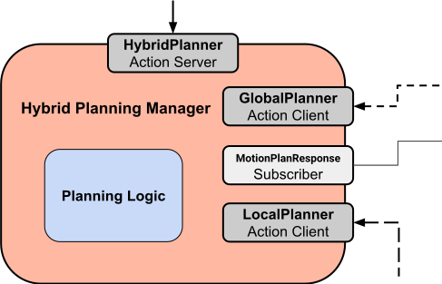
该组件是架构的“大脑”。其主要目的是处理 HybridPlanner 操作请求并根据规划逻辑插件协调运动规划和执行过程。规划逻辑在 PlanningLogic 插件中实现，设计为事件驱动。事件由字符串标识符定义，可能会触发针对全局或本地规划器的操作调用或取消。下图显示了一个简单规划逻辑的示例事件日志： 
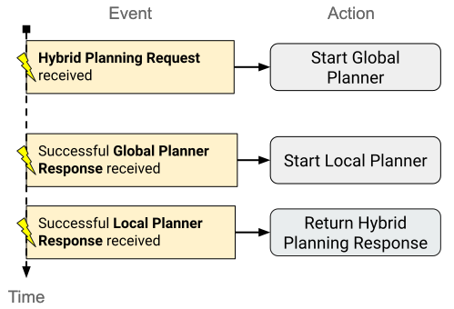
在此示例中，混合规划管理器在收到混合规划请求后启动全局规划器。全局轨迹到达后，本地规划器启动，本地规划器完成后，混合规划管理器返回混合规划响应。   
#### 全局规划组件 （Global Planner）  
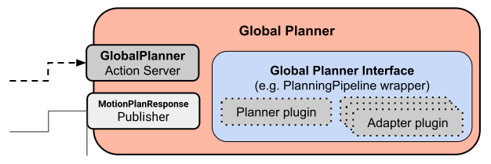   
Global Planner 是该架构中最简单的组件。它提供了一个处理 GlobalPlanner 请求的操作（Action）服务器。这些请求包括通用的 MotionPlanRequests，由 Global Planner 插件处理。默认情况下，这只是 MoveIt 的规划管道，但从技术上讲，任何类型的规划器甚至 MTC 都可以在这里使用。使用操作反馈报告规划结果，并将解决方案轨迹发布到 Local Planner 以供进一步处理。   
#### 局部规划组件 （Local Planner）    
本地规划器还运行一个操作（Action）服务器，用于处理来自混合规划管理器的请求。该操作用于启动和停止执行，还可以配置运行时参数，例如约束或求解器类型。
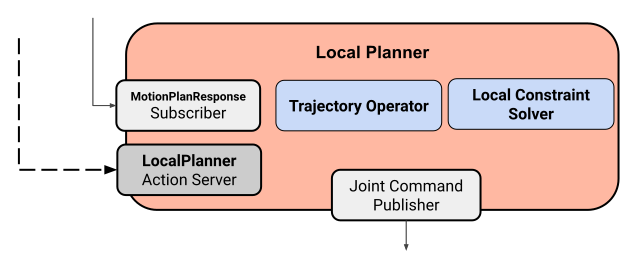   
本地规划器实现基于两个插件：  
1. 轨迹操作器：该插件维护全局参考轨迹，处理来自全局规划器的轨迹更新，并监控当前机器人状态的进程。
2. 局部约束求解器：此插件实现了迭代求解器算法，该算法根据参考轨迹和局部约束生成机器人命令。它可能包括用于动态处理传感器输入或事件更新的附加接口。  

下图显示了混合规划管理器采取行动请求后局部规划器的示例循环周期：  
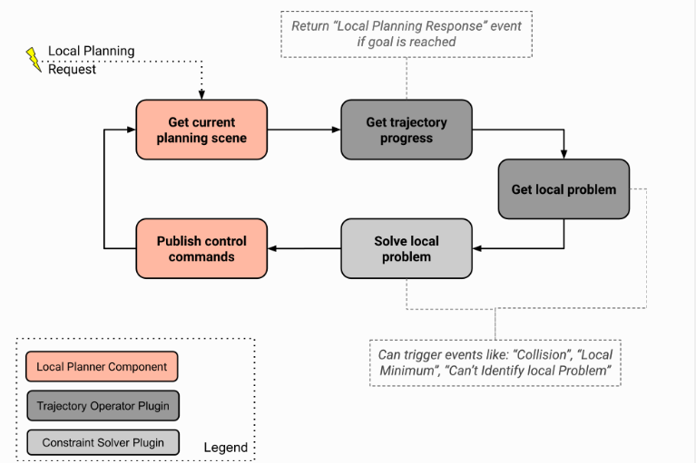    
每次迭代时，局部规划器都会请求当前规划场景，并将当前机器人状态与参考轨迹进行匹配。如果达到目标，则局部规划操作成功完成。否则，将根据当前机器人状态识别当前局部规划问题，然后进行解决。最后，将生成的控制命令发布给机器人控制器。  
它是如何工作的？  
通过绘制可视化不同组件的通信渠道和事件的工作流图，可以最好地理解混合规划器的运行时行为。
下面的图表显示了成功执行轨迹的运行时逻辑。   
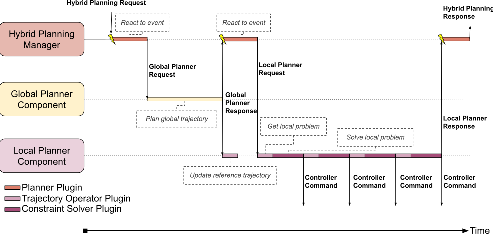    
规划器由混合规划请求调用，这也是混合规划管理器响应的第一个事件。在此示例中，规划器逻辑只是按顺序运行两个规划器。在初始混合规划请求之后，混合规划管理器调用全局规划器。全局规划器计算并发布轨迹，该轨迹由混合规划管理器和本地规划器组件接收。需要注意的是，本地规划器组件仅处理新轨迹，直到被混合规划管理器调用后才开始执行。一旦混合规划管理器请求，本地规划器组件就会开始展开参考轨迹，并在达到最终状态时成功返回操作响应。之后，混合规划管理器返回成功的 HybridPlanningResponse。  
现在让我们考虑一个更困难的场景，其中混合规划器被设计为通过重新规划在执行过程中避开障碍物。下面的动画显示了一个简单的运动，由于碰撞对象的变化，该运动在运行时被固定。  
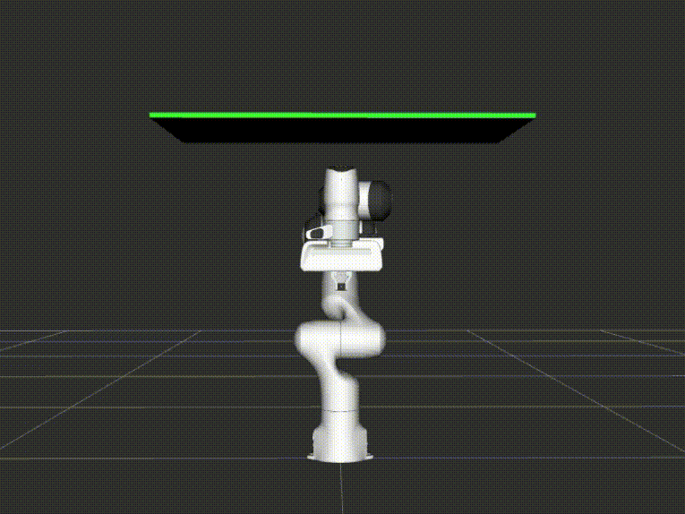  
这里，全局规划过程中出现的碰撞对象在计算出全局轨迹后消失。相反，出现了两个新的碰撞对象，使初始全局轨迹无效。局部规划器检测到即将发生的碰撞并暂停执行，直到全局规划器提供更新的无碰撞轨迹。   
下面您可以看到所描述行为的工作流程。  
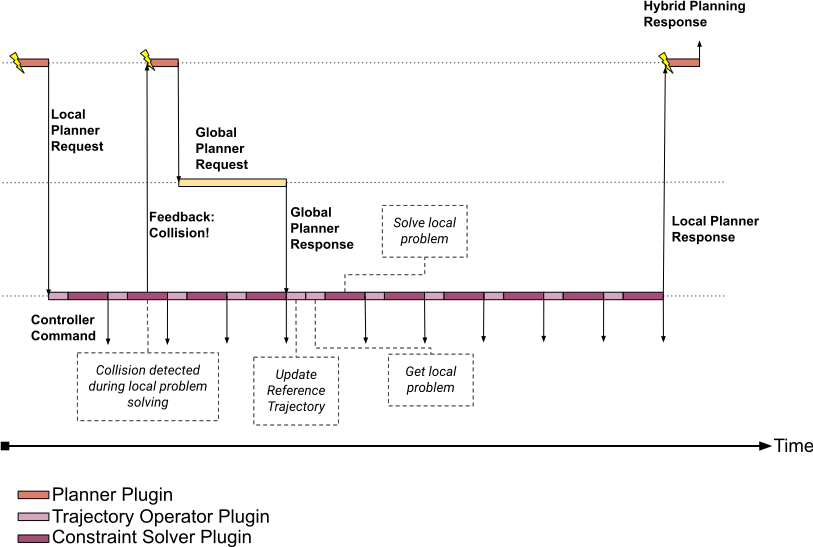
启动与第一个示例相同，但在展开参考轨迹期间，本地规划器检测到碰撞。在这里，规划器逻辑通过重新调用全局规划器做出反应。在计算新的全局解决方案时，本地规划器必须防止机器人与碰撞对象发生碰撞，即保持其当前位置。全局规划器完成计算后，新的全局解决方案将发布到本地规划器，本地规划器的轨迹运算符插件将更新混合到参考轨迹中。之后，本地规划器组件继续遵循参考轨迹，因为更新的解决方案使其能够绕过碰撞对象。
## 运动组（Move Group）   
下图显示了 MoveIt 提供的关键节点move_group的高级系统架构。此节点充当集成器：将所有单个组件拉到一起，为用户提供一组 ROS 操作和服务，代码参考[move_group.cpp](./src/moveit2/moveit_ros/move_group/src/move_group.cpp)。  
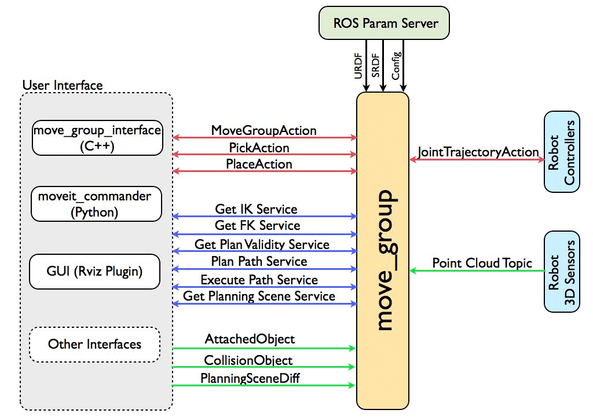  
### 用户界面 （User Interface）
用户可以move_group通过两种方式访问​​提供的操作和服务：
1. 在 C++ 中- 使用[move_group_interface](https://moveit.picknik.ai/main/api/html/classmoveit_1_1planning__interface_1_1MoveGroupInterface.html)包，它提供了一个易于设置的 move_group C++ 接口，代码参考[move_group_interface.cpp](./moveit2/moveit_ros/planning_interface/move_group_interface/src/move_group_interface.cpp)
2. 通过 GUI 使用Rviz （ROS 可视化工具）的运动规划插件

### 配置（Configuration）
move_group是一个 ROS 节点。它使用 ROS param server 获取三种信息：
1. URDF：move_group寻找robot_description参数来获取机器人的 [URDF](./jaka_description/urdf/jaka_zu5.urdf)。
2. SRDF：move_group查找robot_description_semantic参数以获取机器人的 [SRDF](./jaka_zu5_moveit_config/config/jaka_zu5.srdf)。SRDF 通常由用户使用 MoveIt 设置助手创建（第一次）。
3. MoveIt 配置：move_group将查找 MoveIt 特有的其他配置，包括关节限制、运动学、运动规划、感知和其他信息。这些组件的配置文件由 MoveIt 设置助手自动生成，并存储在[config](./jaka_zu5_moveit_config/config/)机器人相应 MoveIt 配置包的目录中。  
```C++    
  // Create the MoveIt MoveGroup Interface
  //node节点会接受参数服务器的参数
  //指定运动组“jaka_arm”，通过"jaka_arm"能找到相关配置项cofig
  using moveit::planning_interface::MoveGroupInterface;
  auto move_group_interface = MoveGroupInterface(node, "jaka_arm");
```
### 机器人接口（Robot Interface）
move_group通过 ROS 话题（topic）和动作（Action）与机器人对话。它与机器人通信来获取当前状态信息（关节位置等）、从机器人传感器获取点云和其他传感器数据以及与机器人上的控制器对话。 
### 关节状态信息（Joint State Information）   
move_group监听主题/joint_states以确定当前状态信息 - 即确定机器人的每个关节的位置。 move_group能够监听此主题上的多个发布者，即使他们只发布有关机器人状态的部分信息（例如，机器人的手臂和移动底座可以使用单独的发布者）。请注意，move_group不会设置自己的关节状态发布者 - 这是必须在每个机器人上实现的功能。  
### 变换信息(Transform Information)
move_group使用 ROS TF 库监控变换信息。这允许节点获取有关机器人姿势的全局信息（以及其他信息）。例如，ROS 导航堆栈将向 TF 发布地图框架和机器人基座框架之间的变换。 move_group可以使用 TF 找出此变换以供内部使用。请注意，move_group仅监听 TF。要从您的机器人发布 TF 信息，您需要robot_state_publisher在机器人上运行一个节点。
### 控制器接口 (Controller Interface) 
move_group使用 FollowJointTrajectoryAction 接口与机器人上的控制器对话。这是一个 ROS 操作接口。机器人上的服务器需要为该操作提供服务 - 该服务器本身不提供move_group。 move_group将仅实例化一个客户端以与机器人上的该控制器操作服务器对话。
总控制类[MoveItControllerManager](./moveit2/moveit_core/controller_manager/include/moveit/controller_manager/controller_manager.h)定义很多虚函数，---》（继承关系）[MoveItSimpleControllerManager](./moveit2/moveit_plugins/moveit_simple_controller_manager/src/moveit_simple_controller_manager.cpp) 进行实例化，在初始化过程initialize()中对关节轨迹控制句柄[FollowJointTrajectoryControllerHandle](./moveit2/moveit_plugins/moveit_simple_controller_manager/include/moveit_simple_controller_manager/follow_joint_trajectory_controller_handle.h)和夹抓控制器句柄[GripperControllerHandle](./moveit2/moveit_plugins/moveit_simple_controller_manager/include/moveit_simple_controller_manager/gripper_controller_handle.h)进行构造，他们都定义sendTrajectory(const moveit_msgs::msg::RobotTrajectory& trajectory)函数，最终由客户端发送controller_action_client_->async_send_goal()，总结就是控制器通过关节轨迹控制句柄和夹抓控制句柄进行发送轨迹，自身还有控制器句柄[MoveItControllerHandle](./moveit2/moveit_core/controller_manager/include/moveit/controller_manager/controller_manager.h)---》（继承关系）类ActionBasedControllerHandleBase==》[ActionBasedControllerHandle](./moveit2/moveit_plugins/moveit_simple_controller_manager/include/moveit_simple_controller_manager/action_based_controller_handle.h)定义客户端去执行取消执行轨迹规划，服务端反馈结果，以及服务端一些状态等信息    
执行此函数是在[TrajectoryExecutionManager::continuousExecutionThread()](./moveit2/moveit_ros/planning/trajectory_execution_manager/src/trajectory_execution_manager.cpp)函数。
在***foxy***版本中先运行驱动
ros2 launch moveit_arm_control arm_control.launch.py 
再运行move_group节点
ros2 launch moveit_arm_control demo.launch.py
最后运行ros2 run rqt_graph rqt_graph 可以得到如下图
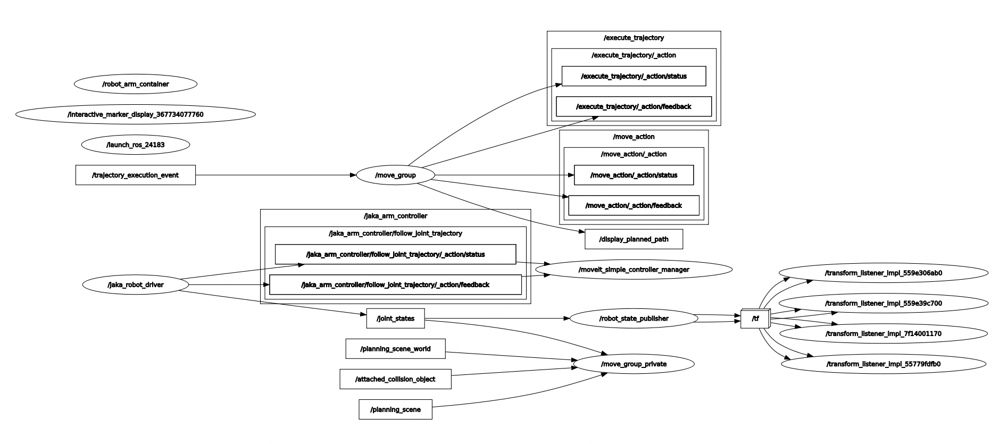
### 规划场景(Planning Scene)  
move_group使用规划场景监视器来维护规划场景，这是世界和机器人当前状态的表示。机器人状态可以包括任何附着在机器人上（由机器人携带）的物体，这些物体被认为是刚性附着在机器人上的。有关维护和更新规划场景的架构的更多详细信息，请参阅下面的**规划场景**部分。  
### 可扩展功能(Extensible Capabilities)
move_group结构易于扩展。拾取和放置、运动学、运动规划等单个功能实际上是作为具有共同基类的单独插件实现的。这些插件可通过一组 ROS yaml 参数和使用 ROS pluginlib 库使用 ROS 进行配置。大多数用户无需配置 move_group 插件，因为它们会在 MoveIt 设置助手生成的启动文件中自动配置。
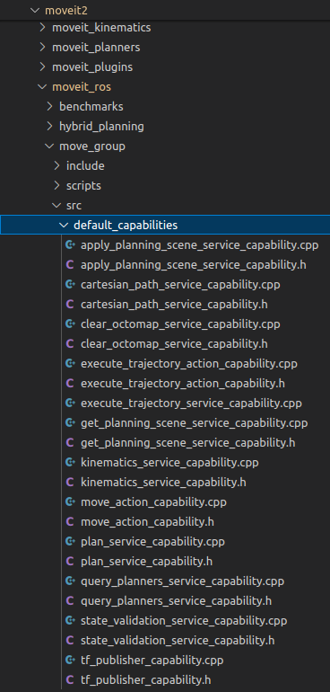  
在页面上点击plan和execute，就会执行函数[MoveGroupMoveAction::executeMoveCallbackPlanAndExecute](./moveit2/moveit_ros/move_group/src/default_capabilities/move_action_capability.cpp)
## 规划场景监控 (Planning Scene Monitor) 
规划场景([planning scene](./moveit2/moveit_core/planning_scene/src/pyplanning_scene.cpp))是一个用于存储机器人周围环境表示以及机器人本身状态的对象。对象（planning scene）的内部状态通常由一个组件（[planning_scene_monitor](./moveit2/moveit_ros/planning/planning_scene_monitor/src/planning_scene_monitor.cpp)）维护，该组件支持以线程安全的方式读取和写入状态。  
具体来说，move_group节点和 rviz 规划场景插件都维护着自己的规划场景监视器（PSM）。move_group节点的 PSM监听主题/planning_scene，并将其规划场景状态发布到主题monitored_planning_scene。后者由 rviz 规划场景插件监听。  
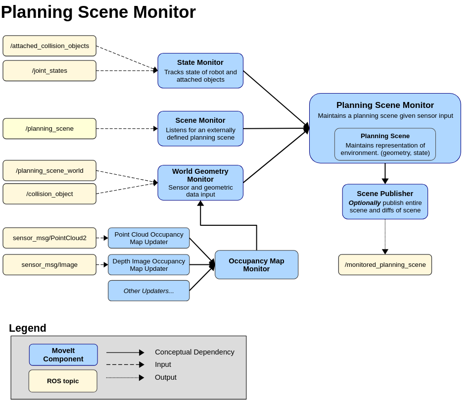  
### 世界几何监视器 （World Geometry Monitor）
世界几何监视器使用来自机器人上的传感器（例如激光雷达或深度摄像头）和用户输入的信息构建世界几何。它使用下面描述的内容构建机器人周围环境的 3D 表示，并使用主题信息对其进行扩充，以添加对象信息。occupancy map monitor 和planning_scene。 代码见[occupancy_map_monitor.cpp](./moveit2/moveit_ros/occupancy_map_monitor/src/occupancy_map_monitor.cpp) 
### 3D 感知 （3D Perception）
MoveIt 中的 3D 感知由占用地图监视器 （occupancy map monitor）处理。占用地图监视器使用插件架构来处理不同类型的传感器输入，如上图所示。具体来说，MoveIt 内置了对处理两种输入的支持：
1. 点云：由插件处理PointCloudOccupancyMapUpdater。[pointcloud_octomap_updater.cpp](./moveit2/moveit_ros/perception/pointcloud_octomap_updater/src/pointcloud_octomap_updater.cpp)
2. 深度图像：由插件处理DepthImageOccupancyMapUpdater。[depth_image_octomap_updater.cpp](./moveit2/moveit_ros/perception/depth_image_octomap_updater/src/depth_image_octomap_updater.cpp)
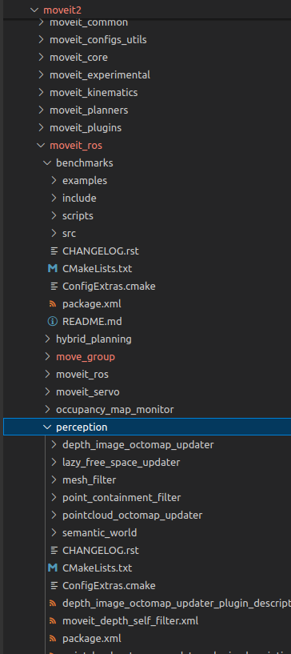
请注意，您可以将自己的类型的更新程序作为插件添加到占用图监视器中  
### 占用栅格地图（Octomap）  
占用地图监视器使用[Octomap](https://octomap.github.io/)来维护环境的占用地图。 Octomap实际上可以对有关单个细胞的概率信息进行编码，尽管 MoveIt 目前未使用此信息。[Octomap](./moveit2/moveit_ros/occupancy_map_monitor/src/occupancy_map_updater.cpp)通过occupancy_map_updater可以直接传递到 MoveIt 使用的碰撞检查库 FCL。  
### 深度图像占用图更新器（Depth Image Occupancy Map Updater）
深度图像占用图更新器包含其自己的自过滤器，即它将从深度图中删除机器人的可见部分。它使用有关机器人的当前信息（机器人状态）来执行此操作。  
## 轨迹处理（Trajectory Processing）
### 时间参数化 （Time parameterization）
运动规划器通常仅生成“路径”，即没有与路径相关联的时间信息。MoveIt 包含几种轨迹处理算法，这些算法可以在这些路径上工作并生成适当时间参数化的轨迹，考虑到对各个关节施加的最大速度和加速度限制。这些限制是从joint_limits.yaml为每个机器人指定的特殊配置文件中读取的。配置文件是可选的，它会覆盖 URDF 中的任何速度或加速度限制。截至 2023 年 1 月，推荐的算法是TimeOptimalTrajectoryGeneration (TOTG)。此算法的一个警告是机器人必须在静止时开始和结束。默认情况下，TOTG 时间步长为 0.1 。相关代码见[time_optimal_trajectory_generation.cpp](./moveit2/moveit_core/trajectory_processing/src/time_optimal_trajectory_generation.cpp)  
## MoveIt 任务构造器(MoveIt Task Constructor)
### 什么是 MoveIt 任务构造器?  
MoveIt 任务构造器 [MTC](./moveit_task_constructor) 框架有助于将复杂的规划任务分解为多个相互依赖的子任务。
MTC 使用 MoveIt 来解决子任务。子任务的信息通过 InterfaceState 对象传递。  
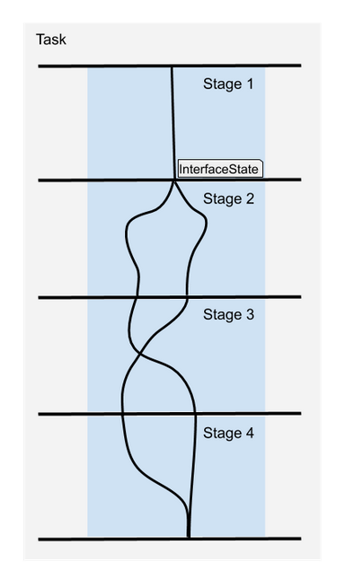  
### MTC 阶段
MTC阶段是指任务执行管道中的组件或步骤。
阶段可以按任意顺序排列，并且其层次结构仅受各个阶段类型的限制。
阶段排列的顺序受到结果传递方向的限制。  
与结果流相关的可能阶段有三个：
1. 生成器
2. 传播者
3. 连接器  
   
### 生成器(Generator Stage)    
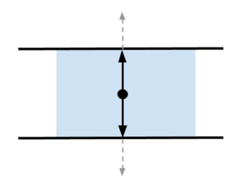
生成器阶段不接收来自相邻阶段的输入。它们计算结果并将其传递到两个方向 - 向前和向后。
MTC 任务的执行从生成器阶段开始。   
最重要的生成器阶段是CurrentState，它将当前机器人状态作为规划管道的起点。  
监控生成器是监控另一个阶段（不相邻）的解决方案以使用该解决方案进行规划的阶段。  
监控生成器的示例 - GeneratePose。它通常监控CurrentState或ModifyPlanningScene阶段。通过监控的解决方案CurrentState，该GeneratePose阶段可以找到它应该围绕其生成姿势的对象或框架。更多信息请参考[generating-stages](https://moveit.picknik.ai/main/doc/concepts/moveit_task_constructor/generating_stages.html#generating-stages)   
### 传播阶段（Propagating Stage）   
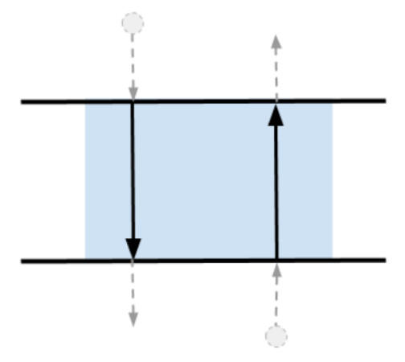   
传播器从一个邻居状态接收解决方案，解决问题，然后将结果传播到另一侧的邻居。
根据具体实施，此阶段可以向前、向后或双向传递解决方案。
传播阶段的示例 移动到某个姿势。此阶段通常用于接近要拾取的物体。更多信息参考[propagating-stages](https://moveit.picknik.ai/main/doc/concepts/moveit_task_constructor/propagating_stages.html#propagating-stages)    
### 连接阶段(connecting-stages)  
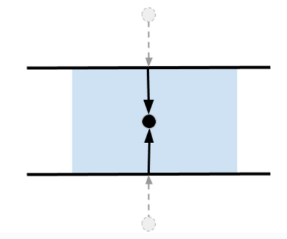   
连接器不会传播任何结果，但会尝试连接相邻阶段提供的开始和目标输入。
连接阶段通常解决起始状态和目标状态之间的可行轨迹。更多信息参考[connecting-stages](https://moveit.picknik.ai/main/doc/concepts/moveit_task_constructor/connecting_stages.html#connecting-stages) 
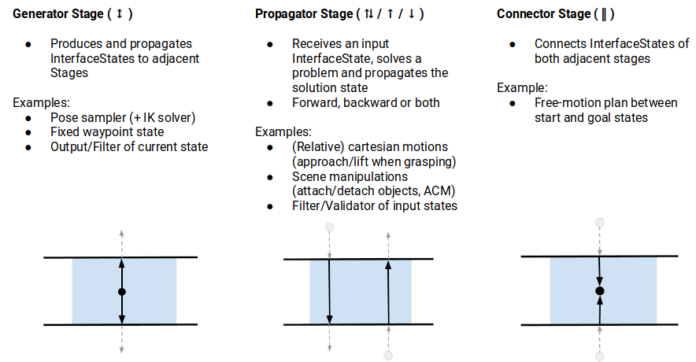 
### 包装器(wrappers)
包装器封装了另一个阶段来修改或过滤结果。
包装器示例 -Compute IK for Generate Grasp Pose阶段。Generate Grasp Pose阶段将产生笛卡尔姿势解决方案。通过封装一个Compute IK阶段围绕着Generate Pose阶段，笛卡尔姿势解决方案可用于Generate Pose阶段产生 IK 解决方案（即产生机器人的关节状态配置以达到姿势）。更多信息参考[wrappers](https://moveit.picknik.ai/main/doc/concepts/moveit_task_constructor/wrappers.html#wrappers)
### MTC 容器（MTC Containers）  
MTC 框架使用容器实现阶段的分层组织，从而实现顺序和并行组合。
MTC 容器有助于组织各阶段的执行顺序。
以编程方式，可以将一个容器添加到另一个容器内。  
目前可用的容器：
1. 串行
2. 平行  

#### 串行容器
串行容器以线性方式组织阶段，并且仅将端到端解决方案视为结果。
MTC 任务默认存储为串行容器。  
#### 平行容器(parallel-containers)
并行容器结合了一系列阶段，以允许规划替代解决方案。更多信息参考[parallel-containers](https://moveit.picknik.ai/main/doc/concepts/moveit_task_constructor/parallel_containers.html#parallel-containers)   
### 初始化 MTC 任务 （Initializing a MTC Task）
将顶层规划问题指定为 MTC Task，将由 Stages 指定的子问题添加到 MTC 任务对象中。  
```C++  
auto node = std::make_shared<rclcpp::Node>();
auto task = std::make_unique<moveit::task_constructor::Task>();
task->loadRobotModel(node);
// Set controllers used to execute robot motion. If not set, MoveIt has controller discovery logic.
task->setProperty("trajectory_execution_info", "joint_trajectory_controller gripper_controller");
```
### 向 MTC 任务添加容器和阶段（Adding containers and stages to a MTC Task）  
向 MTC 任务添加阶段
```C++  
auto current_state = std::make_unique<moveit::task_constructor::stages::CurrentState>("current_state");
task->add(std::move(current_state));
```  
容器源自阶段，因此可以类似地将容器添加到 MTC 任务中
```C++  
auto container = std::make_unique<moveit::task_constructor::SerialContainer>("Pick Object");
// TODO: Add stages to the container before adding the container to MTC task
task->add(std::move(container));
``` 
### 设置规划求解器 （Setting planning solvers） 
进行运动规划的阶段需要求解器信息。   
MTC 中可用的求解器：
1. [PipelinePlanner](./moveit_task_constructor/core/src/solvers/pipeline_planner.cpp)- 使用 MoveIt 的规划管道,默认ompl
2. [JointInterpolation](./moveit_task_constructor/core/src/solvers/joint_interpolation.cpp)- 在起始和目标关节状态之间进行插值。它不支持复杂的运动。
3. [CartesianPath](./moveit_task_constructor/core/src/solvers/cartesian_path.cpp)- 在笛卡尔空间中沿直线移动末端执行器。  

关于如何初始化三种求解器的代码示例
```C++  
const auto mtc_pipeline_planner = std::make_shared<moveit::task_constructor::solvers::PipelinePlanner>(
    node, "ompl", "RRTConnectkConfigDefault");
const auto mtc_joint_interpolation_planner =
    std::make_shared<moveit::task_constructor::solvers::JointInterpolationPlanner>();
const auto mtc_cartesian_planner = std::make_shared<moveit::task_constructor::solvers::CartesianPath>();
```  
这些求解器将被传递到诸如MoveTo、、MoveRelative、Connect等阶段。  
### 设置属性 （Setting Properties）   
每个 MTC 阶段都有可配置的属性。例如 - 计划组、超时、目标状态等。
可以使用下面的函数设置不同类型的属性
```C++  
void setProperty(const std::string& name, const boost::any& value);
```    
### 阶段成本计算器（Cost calculator for Stages） 
子阶段可以轻松地从其父阶段继承属性，从而减少配置开销。  
CostTerm 是计算 MTC 阶段解决方案成本的基本接口。
MTC 中提供 CostTerm 实现：
1. Constant- 为每个解决方案添加固定成本
2. PathLength- 成本取决于轨迹长度，不同关节的重量可选
3. TrajectoryDuration- 成本取决于整个轨迹的执行时间
4. TrajectoryCostTerm- 仅适用于 SubTrajectory 解决方案的成本条款
5. LambdaCostTerm- 传入 lambda 表达式来计算成本
6. DistanceToReference- 成本取决于到参考点的加权关节空间距离
7. LinkMotion- 成本取决于链接的笛卡尔轨迹的长度
8. Clearance- 成本与碰撞距离成反比  

如何使用设置 CostTerm 的示例代码LambdaCostTerm
```C++  
stage->setCostTerm(moveit::task_constructor::LambdaCostTerm(
      [](const moveit::task_constructor::SubTrajectory& traj) { return 100 * traj.cost(); }));
```   
MTC 提供的所有阶段都有默认的成本项。产生轨迹作为解决方案的阶段通常使用路径长度来计算成本。   
### 规划和执行 MTC 任务
规划 MTC 任务将返回MoveItErrorCode。请参阅[此处](https://github.com/moveit/moveit_msgs/blob/ros2/msg/MoveItErrorCodes.msg)以识别不同的错误类型。如果规划成功，您可以预期计划函数将返回moveit_msgs::msg::MoveItErrorCodes::SUCCESS。
```C++  
auto error_code = task.plan()
```    
规划后，提取第一个成功的解决方案并将其传递给执行函数。这将创建一个execute_task_solution动作客户端。动作服务器驻留在execute_task_solution_capability MTC 提供的插件中。该插件扩展了MoveGroupCapability。它MotionPlanRequest从 MTC 解决方案构建并使用 MoveItPlanExecution来驱动机器人
```C++  
auto result = task.execute(*task.solutions().front());
```  


